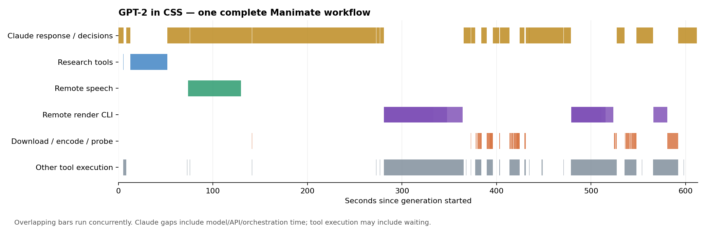

# GPT-2 entirely in CSS: workflow profile

Measured 2026-11-14. **Claude response/decision time was the largest component:
369.6 seconds (60.3%) of a 612.9-second app run.** Remote speech completed in
56.2 seconds while Claude was working; improving TTS further would not remove
56 seconds from this run. The CLI took 614.0 seconds including request/setup.

The final output is 164.7 seconds, 854×480 at 15 fps, with 163.7 seconds of audio
and a deliberate final hold. Nine scenes, 22 narration segments, 646 lines of
scene code. The completed video is in the normal Manimate session
`profile-gpt2-css-e7e5b728` and its library entry is “Running GPT-2 Inside Pure CSS”.

## Reproduction and measurement

Original prompt, unchanged: `https://shubhampatil.dev/blog/gpt2-css`.
Same settings as original session `4add3ad6-a0a4-41dd-ab4e-92a9809da681`:
Claude (`claude-opus-5-5[1m]`), 16:9, Kokoro `af_heart`.

```sh
node scripts/cli.mjs 'https://shubhampatil.dev/blog/gpt2-css' \
  --model claude --aspect 16:9 --voice af_heart \
  --session profile-gpt2-css-e7e5b728 \
  --base-url http://127.0.0.1:3022 --show-events
```

Normal 0.1.28 CLI and packaged standalone app; fresh project, uncached speech,
cloud speech and cloud rendering. The supplied prompt and agent instructions
were not altered for the benchmark. Passive PATH wrappers recorded actual
command boundaries, including background processes. Native Claude timestamps
recorded tool calls/results. The original user app was left running separately.

## Wall-clock accounting

These categories partition the app run without double counting. Speech is
shown separately below because it overlaps other work.

| Component | Seconds | Share |
|---|---:|---:|
| Claude response / decision gaps | 369.6 | 60.3% |
| Remote render CLI, all passes | 142.8 | 23.3% |
| Article research tools | 39.1 | 6.4% |
| Local FFmpeg assembly / padding / frame extraction | 37.2 | 6.1% |
| Clip downloads | 6.7 | 1.1% |
| ffprobe validation | 2.3 | 0.4% |
| Other tool execution / app overhead | 15.1 | 2.5% |
| **Total app run** | **612.9** | **100%** |

Rounding affects the displayed percentage sum. The underlying interval
partition sums to the measured total within 1 ms. Render CLI includes upload,
queueing, server processing and polling; it excludes later clip downloads.



## Inside the Claude portion

This is an attribution by the next observable action, **not a measurement of
private reasoning versus token generation**. Gaps include model generation,
API/network latency, orchestration and small startup costs.

| Next action / purpose | Response-gap seconds |
|---|---:|
| Initial scene-code writing | 128.1 |
| Planning / helper inspection / visual inspection | 97.4 |
| Assembly and verification decisions | 52.5 |
| Code/layout revision decisions | 33.1 |
| Narration writing | 20.9 |
| Final response | 14.1 |
| Render coordination | 11.4 |
| Research coordination | 9.4 |
| Other setup | 2.6 |

Actual WebFetch execution was another 39.1 seconds, counted in research tools.
There was one article fetch and no WebSearch call. No new article search was
needed during iteration. Writing the file itself took 0.25 seconds; generating
the response containing the code took the preceding 128.1 seconds.

## Speech

- One uncached cloud call: **56.25 s** process elapsed / **56.04 s** client elapsed.
- Generated audio: **163.69 s**.
- Cold model load: **3.00 s**; synthesis: **49.53 s**.
- Total server time: **53.66 s**; remaining client/server difference: **2.38 s**
  for transport, auth, container handling and response download combined.
- **56.19 s overlapped Claude response gaps**, with the remaining ~0.06 s
  overlapping a helper inspection. No explicit blocking speech wait was observed.
- Speech finished around 2:10 into the run; initial scene code was saved around
  4:33. Narration was reused throughout the visual revisions.

## Rendering and iteration

| Pass | Scene jobs | Overlapped CLI wall time | Per-job admission + startup range | Per-job render command range |
|---|---:|---:|---:|---:|
| Initial render | 9 | 83.5 s | 2.5–40.8 s | 5.9–39.6 s |
| Layout/transition fixes | 8 | 44.8 s | 2.5–12.3 s | 8.1–27.1 s |
| Final text-size fix | 1 | 14.4 s | 1.8 s | 8.0 s |

All **18 render jobs succeeded**. Render batches were concurrent; adding job
durations would exaggerate the user-visible wait. No startup or capacity retry
was reported. The initial subtitle lint passed for all 22 subtitles.

A first assembled video existed at **6:32.7**, but it was not the finished
quality-checked result. Claude corrected frame rounding/alignment, inspected
contact sheets, fixed overlapping labels and a formula transition, then fixed
an overflowing final line. Final checks and revisions added about **220 s**
after the first assembly. These were useful quality work, not failed render jobs.

Two helper commands failed and were recovered: shell array expansion produced
a nonexistent clip filename; a frame-count probe referenced an undefined Manim
`config`. Neither failure required repeating speech. Their wall time and
subsequent Claude decisions remain included.

## What to optimize next

1. **Reduce code volume and layout revisions.** Provide reusable, tested scene,
   typography and transition helpers. The model wrote 646 lines and then made
   two visual revision passes. This targets both response time and re-rendering.
2. **Make timing/assembly deterministic.** A maintained helper can snap scene
   boundaries to frames, pad holds, download clips and assemble output. It would
   replace ad hoc shell/Python construction, timing repair and shell mistakes.
3. **Document the narration/timestamp interface directly.** The agent inspected
   helper source and the JSON shape repeatedly. A compact schema/example should
   reduce discovery and decision work without changing the video request.
4. **Measure render capacity after the above.** The first batch queued some jobs
   for up to ~14 s before startup; container startup/input loading added up to ~31 s. More capacity alone will not remove cold-start delay. Model
   work still dominates, so increasing render capacity alone cannot remove most
   of the ten-minute workflow.

Further TTS optimization is a lower priority for this workload: it was already
finished before the main scene code. Do not remove visual QA merely to make the
benchmark shorter. Validate any improvement with another run and compare video
scope/quality; identical prompts can produce different scene counts and lengths.

## Evidence and limits

`profile.json`, `tools.csv`, `commands.jsonl`, `exclusive-accounting.json`,
`tts-metrics.json`, and `render-jobs-pass*.json` contain the supporting timings.
`invocation.json` and `completion.json` bound the CLI request. `video-probe.json`
records final media properties; full audio/video decoding passed. Native source
transcript: `~/.manimate/sessions/profile-gpt2-css-e7e5b728/transcripts/43abd49a-3f8f-44e4-b4e7-83e4ab885061.jsonl`.

One realistic run, not production p95 or a controlled local/remote A/B test.
No exact separation of model reasoning, token emission and API latency is
possible from these traces. Passive wrapper overhead is included. The earlier
original video was shorter and had fewer scenes, so its overall runtime is not
an apples-to-apples speed baseline. This evaluation verifies workflow timing,
render success, media integrity and sampled frames; it is not a full technical
fact-check of the generated explainer.

Audit correction: the API field `queue_seconds` includes both scheduler admission and container startup/input loading. The original queue interpretation overstated scheduler wait. See `../audit/render-breakdown.json` for the separated timestamps.
